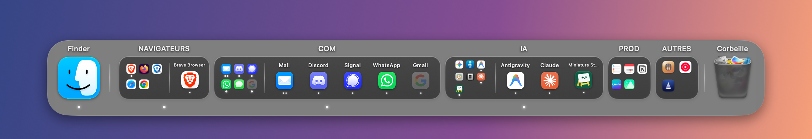

<p align="center">
  
</p>

<h1 align="center">FoldyDock</h1>

<p align="center">A native floating dock for macOS, with iOS-style folders.</p>

<p align="center">
  
</p>

## Features

- **iOS-style folders**: drop one app onto another to group them, then open the folder from the dock.
- **Window picker**: hover an app with several windows to pick one, or click its icon repeatedly to cycle through them.
- **Now Playing widget**: play, pause and skip tracks from Spotify, Apple Music, YouTube Music and more.
- **Calendar widget**: today's date and your next events and reminders.
- **Native look**: frosted glass, light and dark themes, auto-hide, and every Desktop (Space).

## Install

Download the latest version from [Releases](https://github.com/guillaume-murat/foldyDock/releases), or build it yourself (macOS 14+, Swift 5.9+):

```bash
./scripts/build_app.sh install
```

FoldyDock asks for the Accessibility permission to manage windows. Calendar and Reminders access is only requested when you turn on the Calendar widget.

## Contributing

See [CONTRIBUTING.md](CONTRIBUTING.md). Run the tests with `./scripts/run_tests.sh`.

## License

[MIT](LICENSE) © 2026 Guillaume Murat
